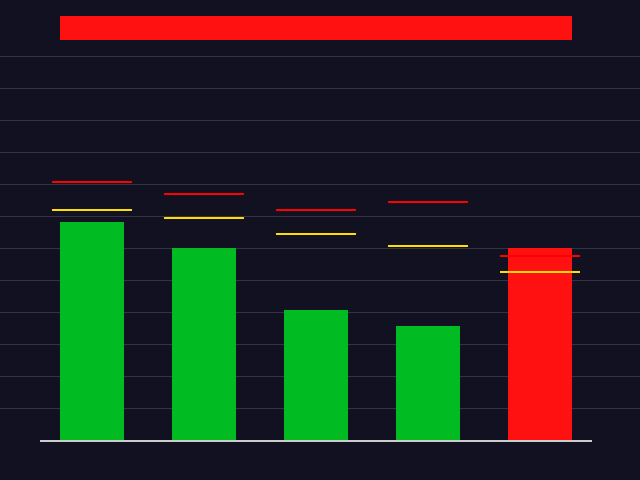
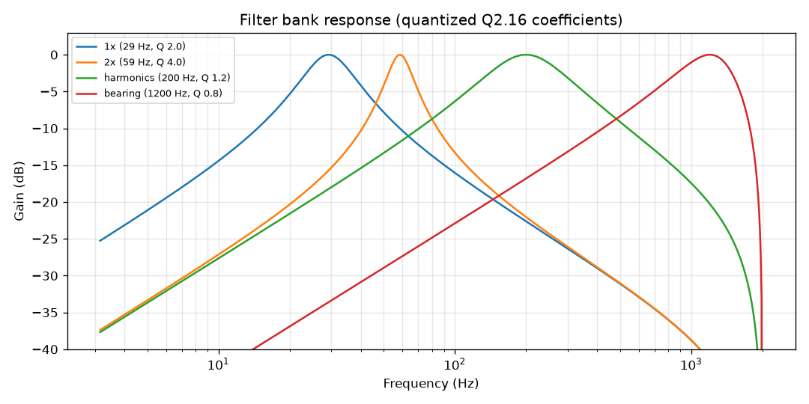
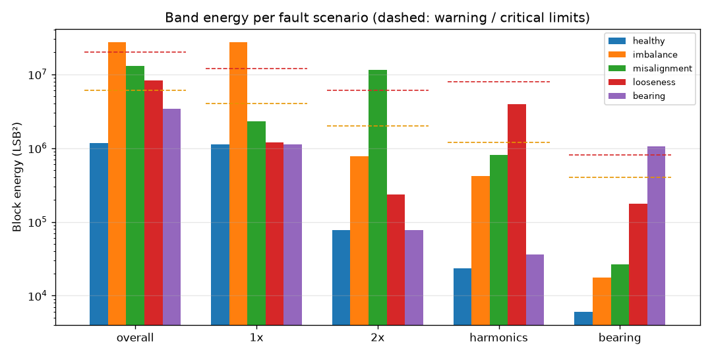

# FPGA Vibration Monitoring System

A fixed-point Verilog pipeline that monitors machine vibration: it splits
an accelerometer signal into diagnostic frequency bands, measures the energy
in each band, raises warning/critical alarms, and draws a live bar-graph
diagnostic display on VGA. Target board: Terasic **DE10-Lite** (MAX 10).

Every stage is verified **bit-exact** against a Python reference model
using synthetic fault signals, down to the individual pixels of the VGA
frame.



*A VGA frame produced by the RTL in simulation for a bearing defect. Bars,
left to right: overall, 1x, 2x, harmonics, bearing band. Yellow and red
markers are the warning and critical limits; the bearing band and the
status strip are red (critical).*

## Signal chain

```
 16-bit samples ─► DC blocker ─► 4-band biquad filter bank ─► block energy ─► alarms ─► VGA display
    4 kHz          (shift-only    (one shared multiplier,      (256 samples,   (hysteresis +   (640x480,
                    IIR, ~5 Hz)    Q2.16 coefficients)          5 channels)     persistence)    no frame buffer)
```

| Band | Centre | Q | Detects |
|---|---|---|---|
| overall | broadband | - | general vibration severity |
| 1x | 29.3 Hz | 2.0 | **imbalance** (running speed, 1758 rpm) |
| 2x | 58.6 Hz | 4.0 | **misalignment** |
| harmonics | 200 Hz | 1.2 | **mechanical looseness** (3x-12x) |
| bearing | 1200 Hz | 0.8 | **bearing defects** (impacts ringing a structural resonance) |



## Design highlights

- **Fixed-point datapath.** 16-bit input scaled into a 24-bit datapath
  (7 extra fractional bits), 18-bit Q2.16 coefficients sized for MAX 10
  18x18 multipliers, 46-bit accumulator, round-to-nearest and saturation
  everywhere a value is narrowed.
- **One multiplier for the whole filter bank.** A sample arrives every
  12,500 clocks, so a pipelined MAC steps through all 20 biquad taps
  (29 clocks per sample) instead of using 20 multipliers. The energy stage
  shares one squarer the same way.
- **DC blocker without a multiplier:** `y = x - x[n-1] + y[n-1] - y[n-1]/128`.
- **Alarms** use absolute severity limits per band (in the spirit of ISO
  10816 zones), **12.5% hysteresis** so a value sitting on a limit cannot
  flicker, and **2-block persistence** (128 ms) before escalating.
- **VGA display drawn on the fly**: bar heights on a log scale (16 px per
  octave, computed with a priority encoder), so no frame buffer RAM is needed.
- **Single source of truth.** Filter coefficients, thresholds and widths are
  generated from the Python design into `rtl/vib_params.vh`; a test fails if
  the generated files are out of date.

## Fault diagnosis

Synthetic accelerometer signals ([`vibmodel/signals.py`](vibmodel/signals.py))
model a healthy machine and four classic faults. Result (identical in the
RTL and the model):

| Scenario | overall | 1x | 2x | harmonics | bearing |
|---|---|---|---|---|---|
| healthy | normal | normal | normal | normal | normal |
| imbalance | **CRITICAL** | **CRITICAL** | normal | normal | normal |
| misalignment | WARNING | normal | **CRITICAL** | normal | normal |
| looseness | WARNING | normal | normal | **WARNING** | normal |
| bearing defect | normal | normal | normal | normal | **CRITICAL** |



The first band design (wider harmonics band, Q 0.7) let imbalance leak into
the harmonics and 2x bands strongly enough to cause false alarms; narrowing
those bands cut the leakage about 2x and the thresholds were set with margin
above it.

## Verification

| Test bench | Checks |
|---|---|
| `cocotb_filters` | DC blocker and all 4 filter outputs **every sample**, bit-exact vs the model: fault signals, impulse/step, full-scale square waves (saturation), random full-range data |
| `cocotb_alarm` | Alarm levels vs the model over 1,200 random blocks at 4 persistence settings, plus a scripted hysteresis/persistence sequence |
| `cocotb_top` | Whole pipeline: block energies and alarm levels bit-exact for every scenario, a fault developing and clearing, and the overrun flag |
| `cocotb_display` | 640x480 sync timing, and a full frame compared **pixel-by-pixel** with a Python renderer |
| `test_model.py` | Filter stability and selectivity, fault diagnosis over several noise seeds, generated files up to date, board wrapper compiles with no warnings |

To check the tests catch real bugs, the filter-bank rounding constant was
deliberately changed (2^15 to 2^14, an error of at most 1 LSB): all four
filter test benches failed on the first sample affected.

A full run takes about 10 minutes, mostly simulating complete VGA frames.

## Running

Requirements: Python 3.10+, [Icarus Verilog](https://bleyer.org/icarus/) 12
on `PATH`, and:

```bash
pip install -r requirements.txt
python -m pytest                 # model tests + all RTL simulations
python -m vibmodel report        # diagnosis table and plots in docs/
python -m vibmodel generate      # regenerate rtl/vib_params.vh and the demo ROM
```

## DE10-Lite demo

[`board/de10lite_top.v`](board/de10lite_top.v) plays the five synthetic
recordings from on-chip ROM at 4 kHz (selected with `SW[2:0]`), shows the
alarm levels on the LEDs and the bar graph on the VGA port, so no sensor is
needed.

**Status:** verified in simulation, and the board wrapper compiles cleanly
with `iverilog -Wall`. It has **not yet been synthesized in Quartus or run
on the board**. Generate the pin assignments with Terasic's System
Builder and add `rtl/`, `board/de10lite_top.v` and `board/vib_demo.hex`.
A natural next step is reading the board's on-board ADXL345 accelerometer
over SPI instead of the ROM.

## Limits

- Band energy is a mean-square value per 64 ms block; there is no FFT, so
  closely spaced components inside one band are not separated.
- Thresholds are tuned for the synthetic signals; a real machine needs a
  baseline measurement first.
- The VGA pixel clock is 25 MHz (from 50 MHz) rather than the nominal
  25.175 MHz, which most monitors accept.
